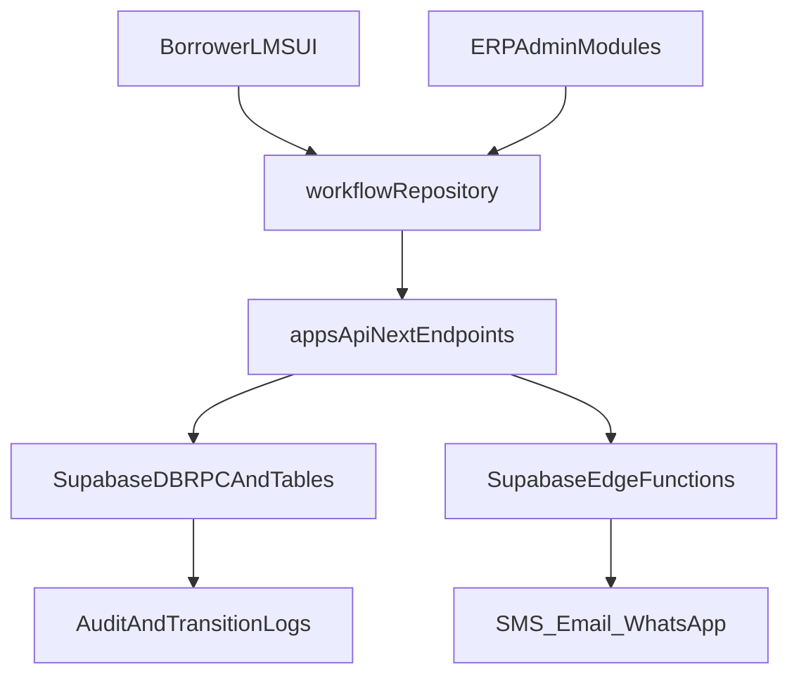

# PHINDU ERP + LMS Full Hardening Plan

## Assumptions Used
- Primary workflow API target: `apps/api-next` (standardized endpoint contract).
- Direct frontend Supabase mutations for critical transitions are treated as temporary legacy and will be fenced/reduced.
- Live endpoint checks are prepared now and executed once base URLs + auth tokens are provided.

## Critical Findings Snapshot
- P0 workflow bypass risks exist in approvals/disbursement flow and contract-signing lifecycle.
- Mixed API paths (direct Supabase + repository API mode) create drift and enforcement inconsistencies.
- ERP modules are function-rich but several have duplicated business logic and weak server-side contract boundaries.
- LMS borrower UX has dead-end links and inconsistent KYC doc-key handling.

## Module-by-Module Execution Sequence

### 1) Workflow Backbone and API Contract (P0 first)
- Standardize transitions to one path via `apps/api-next` transition endpoint and state machine.
- Remove/fence direct status writes in admin pages where transition endpoint exists.
- Verify event visibility handling aligns with `loan_events.visibility` contract.
- Files:
  - [apps/api-next/app/api/v1/loans/[id]/transitions/route.ts](apps/api-next/app/api/v1/loans/[id]/transitions/route.ts)
  - [apps/api-next/src/lib/state-machine.ts](apps/api-next/src/lib/state-machine.ts)
  - [apps/api-next/app/api/v1/loans/[id]/events/route.ts](apps/api-next/app/api/v1/loans/[id]/events/route.ts)
  - [src/services/repositories/workflowRepository.ts](src/services/repositories/workflowRepository.ts)

### 2) Approvals + Contract Signing Integrity (P0)
- Enforce lifecycle: `approved -> contract_signing -> awaiting_disbursement -> disbursed` without auto-sign side effects.
- Remove any approval-time borrower/admin auto-sign stamping.
- Ensure borrower contract widget reflects actionable stage correctly.
- Files:
  - [src/pages/admin/AdminApplications.tsx](src/pages/admin/AdminApplications.tsx)
  - [src/components/dashboard/ContractSigningWidget.tsx](src/components/dashboard/ContractSigningWidget.tsx)

### 3) Disbursement Controls and Idempotency (P0)
- Centralize disbursement completion flow to avoid duplicated business rules across modules.
- Add durable idempotency strategy (DB-backed key/guard) for review/complete operations where needed.
- Keep server-side constraints as final authority.
- Files:
  - [src/pages/admin/AdminDisbursements.tsx](src/pages/admin/AdminDisbursements.tsx)
  - [src/pages/admin/AdminApplications.tsx](src/pages/admin/AdminApplications.tsx)
  - [apps/api-next/app/api/v1/payment-claims/[id]/review/route.ts](apps/api-next/app/api/v1/payment-claims/[id]/review/route.ts)

### 4) Repayments + Claims (ERP/LMS bridge)
- Ensure borrower submit and admin review both route through the same repository/API contract.
- Add borrower-side refresh/realtime consistency for claim status updates.
- Files:
  - [src/pages/Dashboard.tsx](src/pages/Dashboard.tsx)
  - [src/pages/admin/AdminRepayments.tsx](src/pages/admin/AdminRepayments.tsx)
  - [src/services/repositories/workflowRepository.ts](src/services/repositories/workflowRepository.ts)

### 5) Borrower LMS UX Hardening (P1)
- Fix dead-end reminder navigation target.
- Make Profile page honor `?tab=` deep links from dashboard profile shortcuts.
- Normalize identity doc key mapping (`selfie` vs `selfie_holding_nrc`) across apply + KYC components.
- Files:
  - [src/components/dashboard/PaymentReminder.tsx](src/components/dashboard/PaymentReminder.tsx)
  - [src/pages/Profile.tsx](src/pages/Profile.tsx)
  - [src/components/dashboard/BorrowerProfileTab.tsx](src/components/dashboard/BorrowerProfileTab.tsx)
  - [src/components/dashboard/LoanApplicationForm.tsx](src/components/dashboard/LoanApplicationForm.tsx)
  - [src/components/dashboard/KYCStatusWidget.tsx](src/components/dashboard/KYCStatusWidget.tsx)
  - [src/components/dashboard/ProfileDocumentVault.tsx](src/components/dashboard/ProfileDocumentVault.tsx)

### 6) Notifications + Queue + Provider Reliability
- Keep primary+fallback provider behavior explicit and observable.
- Tighten authorization boundaries for notification function callers.
- Reduce config sprawl by consolidating provider settings behavior.
- Files:
  - [supabase/functions/send-notification/index.ts](supabase/functions/send-notification/index.ts)
  - [src/utils/notificationService.ts](src/utils/notificationService.ts)
  - [src/components/admin/NotificationSettingsPanel.tsx](src/components/admin/NotificationSettingsPanel.tsx)

### 7) Payroll + HR Hardening
- Remove N+1 commission aggregation in payroll and enforce period-safe computations.
- Improve HR form hydration/validation path and permission granularity.
- Files:
  - [src/pages/admin/AdminPayroll.tsx](src/pages/admin/AdminPayroll.tsx)
  - [src/pages/admin/AdminHR.tsx](src/pages/admin/AdminHR.tsx)

### 8) Reports and Performance Safety
- Shift heavy client aggregations to server-side views/RPCs progressively.
- Add explicit report permission gating and export guardrails.
- Files:
  - [src/pages/admin/AdminReports.tsx](src/pages/admin/AdminReports.tsx)
  - [src/components/admin/reports/LoanBookReport.tsx](src/components/admin/reports/LoanBookReport.tsx)
  - [src/components/admin/reports/CollectionsReport.tsx](src/components/admin/reports/CollectionsReport.tsx)

### 9) Roles/Permissions and Route Protection Finalization
- Enforce route-level permission checks per admin module, not only staff-level checks.
- Eliminate fail-open behavior when permission payload is empty.
- Files:
  - [src/components/admin/AdminRoute.tsx](src/components/admin/AdminRoute.tsx)
  - [src/hooks/usePermissions.ts](src/hooks/usePermissions.ts)
  - [src/App.tsx](src/App.tsx)

## Endpoint Validation Plan (Live + Code)
- Code-level checks for each module:
  - Route exists and is called through repository.
  - Auth and role checks present.
  - State transition validity and audit logging present.
  - Error contract shape normalized.
- Live checks (ready once access is provided):
  - `/api/v1/health`
  - `/api/v1/loans/:id/transitions`
  - `/api/v1/loans/:id/events`
  - `/api/v1/repayments/:id/payment-claims`
  - `/api/v1/admin/payment-claims`
  - `/api/v1/payment-claims/:id/review`
  - `/api/v1/notifications/me` and `/api/v1/notifications/:id/read`

## Architecture Alignment Flow

## Done Criteria for “Full Functional LMS + ERP”
- No critical status transition can occur outside validated server path.
- Approvals/disbursement/contract signing lifecycle is coherent and auditable.
- Borrower apply/pay/profile/reminder journeys have no dead-end UX paths.
- Notifications send with primary/fallback reliability and controlled caller permissions.
- HR/payroll/reporting paths are permission-gated, performant, and consistent.
- All critical endpoints pass code and live validation scripts.

## Risk-Control Notes
- Highest risk remains dual-write behavior while migration to primary API path is in progress.
- External LMS adapter remains a Phase 2 candidate unless explicitly required now.
- Push subscription backend remains disabled by design until durable subscription storage is implemented.