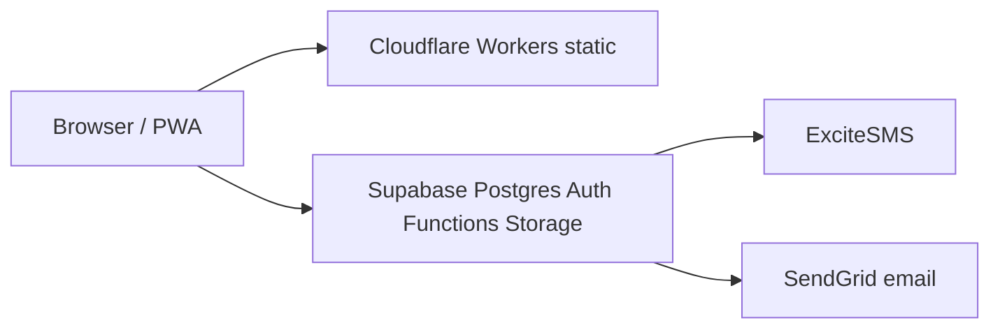

# Phindu — enterprise hosting (simple, stable)

## What you have today (correct pattern)

This is **not** “random Cloudflare + random Supabase with no structure.” It is a standard **Jamstack + BaaS** layout:

| Layer | Provider | Role |
|--------|-----------|------|
| **Public UI** | **Cloudflare Workers** (static assets) | Hosts built HTML/JS/CSS only — no business logic on the edge |
| **API / data / auth** | **Supabase** (owned project `seobilifwyxhtjvsgqpc`) | Postgres, RLS, Auth, Storage, Edge Functions (SMS, OTP, notifications) |
| **DNS / TLS** | **Cloudflare** zone `phindu.com` | Routes hostnames to workers |

**Live routes (verified in Cloudflare):**

| Hostname | Worker |
|----------|--------|
| `https://app.phindu.com` | `phinduloans-borrower` |
| `https://office.phindu.com` | `phinduloans-staff-web` |
| `https://phindu.com` | `phinduloans-staff-web` (marketing + office dual-host build) |

Browsers talk **directly to Supabase** from the SPA (anon key + RLS). Cloudflare does **not** sit in the database path — that is normal and fine.



## What causes “lots of logs and bugs” (and how to avoid it)

| Problem | Cause | Fix |
|---------|--------|-----|
| Stale admin UI / chunk errors | Old `index.html` cached after deploy | **Purge Cloudflare cache** after deploy; app has chunk recovery — still redeploy both workers |
| Data not updating in UI | React Query cache + missing RLS | Shipped invalidation + run SQL migrations on **production** Supabase |
| Two sources of truth for products | `VITE_API_LOAN_PRODUCTS=true` + Supabase | **Keep API mode off** unless `apps/api-next` is deployed and maintained |
| Legacy Lovable Supabase (`yqrf…`) | Not in your CLI account | **Migrate data** into `seobilifwyxhtjvsgqpc` then point all env/secrets there — see `docs/SUPABASE_OPS.md` |
| Duplicate repo tree | Untracked root `src/` | **Do not deploy** — only `apps/staff-web`, `apps/borrower-mobile`, `packages/shared` |
| SMS failures | Missing `EXCITESMS_*` secrets or stale DB token | See `docs/EXCITE_SMS_RELOAD.md` — secrets win over Admin UI |

## Recommended “simple enterprise” setup

1. **One production Supabase project:** `seobilifwyxhtjvsgqpc` (link + `npx supabase db push`).
2. **Two Cloudflare workers only:** borrower + staff (already in place).
3. **Deploy path:** push to `main` → GitHub Actions **or** local `npm run deploy:production` (with Wrangler logged in).
4. **After every deploy:** purge cache for `phindu.com` (script below or Cloudflare dashboard).
5. **SQL changes:** `npx supabase db push --yes` (linked project) or `node scripts/apply-supabase-sql.mjs <file>`.
6. **No second backend** until needed — skip Nest `backend/` and `apps/api-next` in production unless you commit to hosting them.

## Ops commands

```bash
# Build + deploy both surfaces (Wrangler auth required)
npm run deploy:production

# Purge CDN cache (needs CLOUDFLARE_API_TOKEN + zone id)
node scripts/purge-phindu-cache.mjs

# Apply SQL when DATABASE_URL or Supabase CLI is configured
node scripts/apply-supabase-sql.mjs supabase/scripts/APPLY_PENDING_BORROWER_AND_LOAN_DELETE_20261005.sql
```

## GitHub Actions secrets (production)

| Secret | Purpose |
|--------|---------|
| `CLOUDFLARE_API_TOKEN` | Deploy workers |
| `CLOUDFLARE_ACCOUNT_ID` | `051855548968fa4737a8c416f4c6f760` |
| `VITE_SUPABASE_URL` | `https://seobilifwyxhtjvsgqpc.supabase.co` |
| `VITE_SUPABASE_PUBLISHABLE_KEY` | Anon key for builds |

## Spacemail / CRM email (future)

Inbox inside Phindu is **IMAP/SMTP to Spacemail**, not Spaceship domain API. Plan as a separate module after hosting and SMS are stable.
